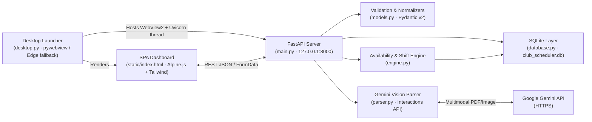

# Club Tracker (ClubPulse Operations)

**University Club Timetable & Availability Analyzer** — a local-first desktop and web application built for university student clubs.

Club Tracker extracts academic timetables from PDFs and images using Google Gemini Vision (`gemini-3.8-flash` with automatic Gemini 3.x Flash failover), maps club members to their academic promos and TD/TP groups, and analyzes real-time team availability — distinguishing **FREE**, **COURS**, **TD**, and **TP** sessions — to power live radar lookups, weekly meeting heatmaps, and fair exhibition/stand shift rotations.

---

## Key Features

- **Batch AI Vision Timetable Scanner**
  - Drag-and-drop one or multiple timetable PDFs or images (`PDF`, `PNG`, `JPEG`, `WEBP`).
  - Automatically splits multi-section PDFs and multi-group cells (e.g., `TD Algo G1/G2`, `G3-G4`) into normalized canonical slots across Saturday–Thursday and six 90-minute daily blocks (`08:00-09:30` through `15:30-17:00`).
  - Handles per-group sheet headers (such as `L2_S2-G6`) by assigning `ALL` to `COURS` lectures and the inferred group (`G6`) to `TD`/`TP` sessions.
  - Interactive staging queue with **Visual Weekly Grid** and **Editable Row Table** previews, plus merge/overwrite controls when updating existing promos.

- **Promo & Member Roster Management**
  - Rich member profiles including department, club role, academic promo, normalized group code (`15` → `G15`), Discord handle, phone, email, `is_active` status, and `shift_exempt` flag.
  - Dedicated **Promo Members Manager** modal to inspect schedule linkage (`matching_slots_count`), bulk-assign existing members to a promo/group, or quick-add new members.
  - Deduplicated CSV bulk import (supporting English/French header aliases and `update`/`skip` duplicate modes), downloadable CSV template, and UTF-8-BOM Excel-friendly CSV export.

- **Live Availability Radar**
  - Instant 4-column Kanban breakdown (**FREE**, **COURS**, **TD**, **TP**) for any day and 90-minute slot, plus a one-click **Right Now** clock sync button.
  - Filter by department, promo, active/inactive status, single session bucket, or live search across names, roles, Discord handles, modules, and classrooms.

- **Weekly Availability Heatmap & Saved Meetings**
  - 6-day × 6-slot matrix showing both **Weighted Score** (`FREE = 1.0`, `COURS = 0.5`, `TD/TP = 0.0`) and **Strict Free** (`100% Free` only) modes.
  - Automatically ranks the **Top 3** recommended meeting windows, opens a slide-over drill-down drawer per cell, persists scheduled meetings in SQLite with live-recomputed expected attendance, and copies Discord-formatted announcements.

- **Exhibition & Stand Shift Planner**
  - Generates balanced shift schedules for club stands, open days, and university fairs.
  - Strictly excludes `TD`/`TP` conflicts, inactive members, shift-exempt members (configurable), and ad-hoc unavailable members.
  - Enforces fairness load-balancing and a **max-2-consecutive-shifts** protection guard, with optional `COURS` backup fallback.
  - Supports manual add/swap/remove adjustments, saving/reloading shift plans in SQLite, Discord Markdown copy, and CSV export.

- **Local-First & Portable Workspace Backups**
  - Zero external database servers required: uses SQLite (`club_scheduler.db`) in WAL mode with foreign key cascading and automatic additive migrations.
  - Full workspace JSON snapshot export/restore (`merge` or `replace`), live binary SQLite `.db` backup download, CSV roster export, and confirmed factory reset.

---

## Technology Stack

| Layer | Technologies |
| :--- | :--- |
| **Backend API** | Python 3.11+, FastAPI, Uvicorn, Pydantic v2, `python-multipart`, `python-dotenv` |
| **AI Extraction** | Google GenAI SDK (`google-genai`), Gemini Interactions API (`gemini-3.8-flash` + automatic 3.x Flash failover) |
| **Database** | SQLite 3 (WAL mode, `PRAGMA foreign_keys = ON`, binary backup via `sqlite3.backup`) |
| **Frontend SPA** | Build-free single-page app (`static/index.html`) using Tailwind CSS (CDN) and Alpine.js 3.14.8 (CDN) |
| **Desktop Packaging** | `pywebview` (Microsoft Edge WebView2 on Windows, automatic browser app fallback), PyInstaller |
| **Testing & Linting** | `pytest` / `unittest`, FastAPI `TestClient` (`httpx`), `ruff` |

---

## Architecture Overview



### Core Modules

| File | Responsibility |
| :--- | :--- |
| [main.py](main.py) | FastAPI application, SPA routing, REST API endpoints, CSV/JSON import-export, and settings management |
| [models.py](models.py) | Pydantic v2 schemas, canonical day/slot/group/session-type/department/role normalizers |
| [engine.py](engine.py) | Slot conflict resolution (`TP > TD > COURS`), weekly heatmap aggregation, and fair shift rotation scheduler |
| [parser.py](parser.py) | Gemini Vision multimodal timetable extraction, multi-group splitting, deduplication, and model failover |
| [database.py](database.py) | SQLite connection lifecycle, DDL schema, additive column migrations, and consistent binary backup helper |
| [desktop.py](desktop.py) | Native desktop launcher managing a background Uvicorn thread and `pywebview` window with fallback browser mode |
| [build_desktop.py](build_desktop.py) | PyInstaller build script for compiling standalone Windows desktop distributions (`--onedir` or `--onefile`) |
| [static/index.html](static/index.html) | Self-contained dark-mode SPA implementing Live Radar, Heatmap & Meetings, Shift Planner, Scanner, and Roster views |

---

## Project Structure

```text
.
├── main.py                     # FastAPI server & REST API endpoints
├── models.py                   # Pydantic schemas & normalization utilities
├── engine.py                   # Availability radar, heatmap & shift rotation engine
├── parser.py                   # Gemini Vision timetable extraction pipeline
├── database.py                 # SQLite schema, migrations & backup helpers
├── desktop.py                  # Native desktop launcher (pywebview + Uvicorn thread)
├── build_desktop.py            # PyInstaller Windows build script
├── ClubTracker.spec            # Portable PyInstaller specification
├── ClubTracker.bat             # Windows desktop launcher script
├── run.bat                     # Windows web development server launcher
├── run.sh                      # Linux / macOS web development server launcher
├── static/
│   └── index.html              # Single-page frontend dashboard
├── tests/
│   ├── test_models.py          # Normalization & schema unit tests
│   ├── test_engine.py          # Radar, heatmap & shift fairness unit tests
│   ├── test_parser.py          # Extraction normalization & mock Gemini tests
│   └── test_api.py             # End-to-end FastAPI integration tests
├── .github/
│   ├── workflows/ci.yml        # Automated CI (Ruff, pytest, OpenAPI & hygiene checks)
│   ├── ISSUE_TEMPLATE/         # Bug report & feature request forms
│   └── PULL_REQUEST_TEMPLATE.md
├── .env.example                # Environment variable template (placeholders only)
├── requirements.txt            # Runtime & desktop dependencies
├── requirements-dev.txt        # Test & lint dependencies (pytest, httpx, ruff)
├── pyproject.toml              # Pytest & Ruff configuration
├── CHANGELOG.md                # Release history
├── CONTRIBUTING.md             # Developer setup & contribution guide
├── CODE_OF_CONDUCT.md          # Community code of conduct
├── LICENSE                     # MIT License
└── SECURITY.md                 # Security model & vulnerability reporting
```

---

## Prerequisites

- **Python 3.11 or newer** (`python --version`)
- **Internet connection** for:
  - Loading Tailwind CSS, Alpine.js, and Google Fonts CDN assets in the UI
  - Calling the Google Gemini API when using the AI Vision Timetable Scanner (all other features work offline against local SQLite)
- **Google Gemini API Key** *(optional, required only for AI timetable scanning)* — available from [Google AI Studio](https://aistudio.google.com/apikey)
- **Windows Desktop Mode**: Microsoft Edge WebView2 Runtime (pre-installed on Windows 10/11)

---

## Installation

### 1. Clone the repository

```bash
git clone https://github.com/Theworld-exe/Club-Tracker.git
cd Club-Tracker
```

### 2. Create a virtual environment and install dependencies

**Windows (PowerShell):**
```powershell
python -m venv .venv
.\.venv\Scripts\Activate.ps1
pip install -r requirements.txt
```

**macOS / Linux:**
```bash
python3 -m venv .venv
source .venv/bin/activate
pip install -r requirements.txt
```

For development (testing & linting), also install dev dependencies:
```bash
pip install -r requirements-dev.txt
```

---

## Environment Configuration

Copy `.env.example` to `.env` and add your Gemini API key if you want to use AI timetable scanning:

```bash
cp .env.example .env
```

You can also enter, test, or clear your `GEMINI_API_KEY` directly from the **Settings** modal inside the app (which persists it to your local `.env`).

| Variable | Required | Default | Description |
| :--- | :--- | :--- | :--- |
| `GEMINI_API_KEY` | For AI scanning | *(empty)* | Google Gemini API key used by `/api/promos/scan` and `/api/settings/test-key`. |
| `GEMINI_MODEL` | No | `gemini-3.8-flash` | Overrides the primary Gemini model. Deprecated `gemini-2.0-flash` / `gemini-2.5-flash` values automatically upgrade to `gemini-3.8-flash`. |
| `CLUB_DB_PATH` | No | `./club_scheduler.db` | Custom path for the SQLite database file (defaults to the executable directory in bundled builds). |
| `CLUB_ENV_PATH` | No | `./.env` | Custom path for the `.env` file read and written by the in-app Settings modal. |

> **Security Note:** `.env` and `*.db` are excluded in `.gitignore`. Never commit your API key or personal club member database to version control.

---

## Running the Application

### Option 1: Desktop Application (Windows / Cross-Platform)

Double-click `ClubTracker.bat` on Windows, or run from a terminal:

```powershell
.\ClubTracker.bat
```

Or invoke `desktop.py` directly inside your virtual environment:

```bash
python desktop.py
```

Useful CLI flags for `desktop.py`:
- `--host 127.0.0.1` — Loopback host to bind (default: `127.0.0.1`)
- `--port 8000` — Preferred port; automatically falls back to `8001–8099` if busy
- `--browser` — Open in Microsoft Edge app mode / default browser instead of `pywebview`
- `--debug` — Enable WebView developer tools

`desktop.py` starts FastAPI in a managed background thread, waits for `/api/settings/status`, opens the native desktop window (falling back gracefully to Edge app mode or the default browser if WebView2 is unavailable), and shuts down the backend cleanly when closed. Diagnostic output is written to `desktop.log`.

### Option 2: Web Development Server (Auto-Reload)

**Windows:**
```powershell
.\run.bat
```

**macOS / Linux:**
```bash
chmod +x run.sh
./run.sh
```

**Or directly with Uvicorn:**
```bash
uvicorn main:app --host 127.0.0.1 --port 8000 --reload
```

Then open:
- **Dashboard:** `http://127.0.0.1:8000`
- **Interactive OpenAPI Docs (Swagger UI):** `http://127.0.0.1:8000/docs`
- **ReDoc:** `http://127.0.0.1:8000/redoc`

---

## Building the Standalone Windows Executable

Package Club Tracker into a portable Windows desktop distribution with PyInstaller:

```powershell
# Standalone directory bundle (recommended for faster startup): dist/ClubTracker/ClubTracker.exe
.\.venv\Scripts\python.exe build_desktop.py

# Single-file portable executable: dist/ClubTracker.exe
.\.venv\Scripts\python.exe build_desktop.py --onefile
```

Notes:
- By default, `build_desktop.py` copies `.env.example` (never your local `.env`) into `dist/ClubTracker/` so distributed builds cannot accidentally leak API keys.
- Pass `--include-env` **only** for private personal builds that you do not share.
- On launch, the compiled executable stores `club_scheduler.db`, `.env`, and `desktop.log` alongside `ClubTracker.exe`.

---

## Testing & Code Quality

Run the full automated test suite (uses isolated temporary SQLite databases and mocked Gemini clients — no API key required):

```bash
pytest -v
```

Or with Python's built-in `unittest` runner:

```bash
python -m unittest discover -s tests -v
```

Run static linting with Ruff:

```bash
ruff check .
```

---

## Availability Scoring & Conflict Rules

When evaluating a member for a given `(day, time_slot)`:

1. **Matching slots**: All `schedule_slots` for the member's `promo_id` where `group_target = 'ALL'` or `group_target = member.group_name`.
2. **Overlap priority**: Strictly `TP > TD > COURS` (if a section lecture overlaps a member's lab or TD, the mandatory session wins).
3. **Weighted availability score**:
   - `FREE` = `1.0`
   - `COURS` = `0.5` *(lecture — potentially flexible)*
   - `TD` = `0.0` *(mandatory)*
   - `TP` = `0.0` *(mandatory lab)*
4. **Shift rotation fairness**:
   - Prioritizes `FREE` members over `COURS` fallback (when enabled) and strictly excludes `TD`, `TP`, inactive, shift-exempt (unless opted in), and manually excluded members.
   - Penalizes assigning a member to a 3rd consecutive slot (`max-2-consecutive` guard), balances total shifts assigned across the day, and avoids back-to-back slots when rested candidates exist.

---

## API Reference Summary

Full interactive request/response schemas are served at `http://127.0.0.1:8000/docs`.

| Category | Endpoints |
| :--- | :--- |
| **Settings** | `GET /api/settings/status`, `POST /api/settings/api-key`, `POST /api/settings/test-key` |
| **Promos & Schedules** | `POST /api/promos/scan`, `GET /api/promos`, `POST /api/promos`, `PUT /api/promos/{id}`, `DELETE /api/promos/{id}`, `GET/POST /api/promos/{id}/slots`, `PUT/DELETE /api/slots/{id}`, `GET/POST /api/promos/{id}/members`, `POST /api/promos/{id}/members/assign` |
| **Members & CSV** | `GET /api/members`, `POST /api/members`, `PUT /api/members/{id}`, `DELETE /api/members/{id}`, `GET /api/members/export-csv`, `POST /api/members/bulk-csv` |
| **Analysis & Shifts** | `GET /api/analysis/slot`, `GET /api/analysis/heatmap`, `POST /api/analysis/shifts` |
| **Saved Shift Plans** | `GET /api/shift-plans`, `POST /api/shift-plans`, `GET /api/shift-plans/{id}`, `PUT /api/shift-plans/{id}`, `DELETE /api/shift-plans/{id}` |
| **Saved Meetings** | `GET /api/meetings`, `POST /api/meetings`, `DELETE /api/meetings/{id}` |
| **Workspace & Backup** | `GET /api/workspace/export`, `GET /api/workspace/export-db`, `POST /api/workspace/import`, `DELETE /api/workspace/reset?confirm=RESET` |

---

## Troubleshooting

- **Desktop window does not open on Windows**
  - Check `desktop.log` in the project directory for startup details.
  - Ensure [Microsoft Edge WebView2 Runtime](https://developer.microsoft.com/en-us/microsoft-edge/webview2/) is installed, or run `python desktop.py --browser` to use browser app mode.
- **Port 8000 already in use**
  - `desktop.py` automatically falls back to ports `8001–8099`. For `uvicorn`, pass `--port 8001`.
- **AI timetable scan returns 401 or 502**
  - Click **Set API Key** in the top bar and run **Test Connection** to verify your `GEMINI_API_KEY`.
  - Temporary 503 high-demand errors automatically fail over across the Gemini 3.x Flash chain configured in [parser.py](parser.py).
- **UI styles or interactivity missing offline**
  - The dashboard loads Tailwind CSS and Alpine.js from public CDNs (`cdn.tailwindcss.com` and `cdn.jsdelivr.net`). Ensure internet access is available when opening the UI.

---

## Contributing & Security

- Please read [CONTRIBUTING.md](CONTRIBUTING.md) and [CODE_OF_CONDUCT.md](CODE_OF_CONDUCT.md) before opening a pull request.
- See [SECURITY.md](SECURITY.md) for deployment security notes and responsible vulnerability disclosure instructions.

---

## License

This project is licensed under the **MIT License** — see the [LICENSE](LICENSE) file for details.

## Maintainer

- **Theworld-exe** — [github.com/Theworld-exe](https://github.com/Theworld-exe)
